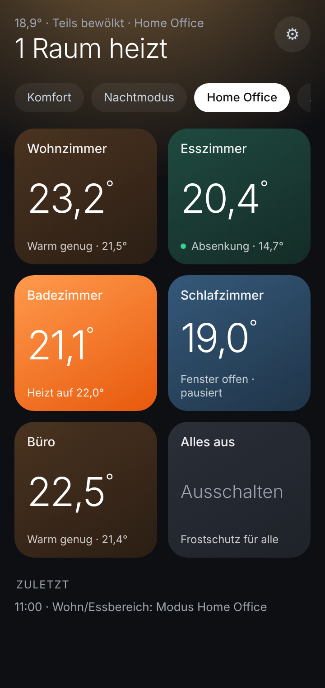
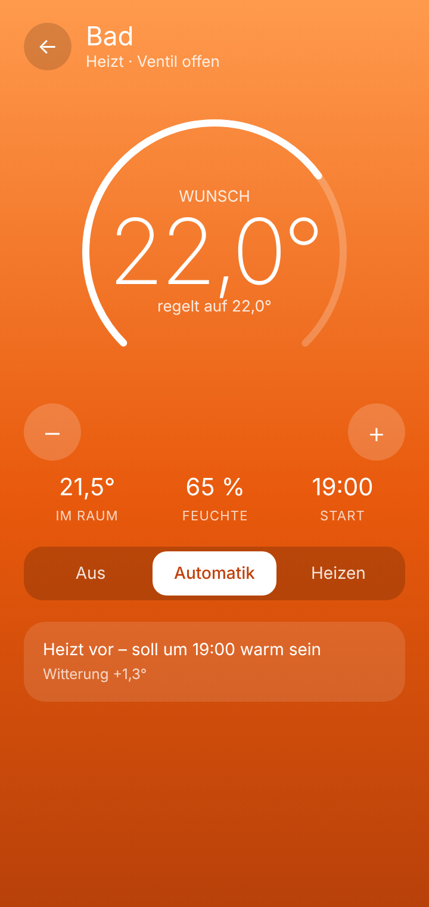

# Smarte Heizung – Android-App für Home Assistant

Eine schlanke Heizungs-App für **Home Assistant**: alle Räume auf einen Blick, Farbe = Zustand
(heizt, Absenkung, Fenster offen, aus), Wunschtemperatur per Drehregler, Himmel passend zum Wetter.
Sie **liest und bedient nur, was dein Home Assistant ihr sagt** – deine Automationen und Skripte bleiben zuständig.

> **Status: Test-Version.** Privates Projekt, ohne Gewähr. **Verbesserungsvorschläge und Fehlermeldungen
> sind ausdrücklich erwünscht** – bitte als [Issue](../../issues), mit Handy-Modell, App-Version (⚙️)
> und was du erwartet hast. Änderungen am Projekt nimmt nur der Inhaber vor (siehe [LICENSE](LICENSE)).

---

## Was du brauchst
- Android **8.0 oder neuer**
- **Home Assistant** (getestet mit 2026.10), erreichbar im Heimnetz und optional unterwegs (z. B. Nabu Casa)
- ein **langlebiger Zugriffstoken** (Home Assistant → Profil → Sicherheit → „Token erstellen“).
  Ein normaler Benutzer ohne Admin-Rechte reicht.

## 1. App installieren
1. Unter [**Releases**](../../releases/latest) die Datei `Heizung-1.0.xx.apk` auf dem Handy herunterladen.
2. Antippen → Android fragt einmalig „Apps aus dieser Quelle installieren?“ → erlauben → **Installieren**.
   Bleibt der Download im Browser hängen: in Chrome ⋮ → Downloads nachsehen, ggf. „Trotzdem herunterladen“ bestätigen.
3. **Updates kommen danach von selbst**: Die App prüft beim Öffnen, ob es eine neuere Version gibt,
   lädt sie selbst und öffnet den Installer. Einmal erlaubst du „Apps aus dieser Quelle“ für die Heizungs-App.

## 2. Home Assistant vorbereiten (einmalig, ca. 5 Minuten)
Die App kennt keine Entitäten fest. Ein kleines Skript in Home Assistant sagt ihr, welche Räume es gibt.

1. **Vorlage ablegen:** [`homeassistant/heizung_app.jinja`](homeassistant/heizung_app.jinja) nach
   `config/custom_templates/heizung_app.jinja` kopieren (Ordner ggf. anlegen, z. B. mit dem File-Editor-Add-on).
   Darin die Liste `raeume` an deine Thermostate (`climate.*`) anpassen, optional Fensterkontakte und die Wetter-Entität.
2. **Vorlagen neu laden:** Entwicklerwerkzeuge → Aktionen → `homeassistant.reload_custom_templates` → Ausführen.
3. **Skript anlegen:** Einstellungen → Automationen & Szenen → Skripte → Neues Skript → ⋮ → „In YAML bearbeiten“ →
   Inhalt von [`homeassistant/heizung_app_status.yaml`](homeassistant/heizung_app_status.yaml) einfügen → speichern.
   Die Skript-ID muss **`heizung_app_status`** sein.
4. **Testen:** Entwicklerwerkzeuge → Aktionen → `script.heizung_app_status` → „Antwort“ anzeigen.
   Dort sollten deine Räume mit Temperaturen stehen.

Mit dieser Vorlage stellt die App die Solltemperatur direkt am Thermostat.
Hast du eigene Heizungs-Skripte, die einen Helfer (`input_number`) lesen, trag den Helfer als `wunsch_entity` ein –
dann bedient die App nur den Helfer. Hausmodus-Knöpfe, „Alles aus“ und Aus/Automatik/Heizen erscheinen nur,
wenn du die passenden Felder füllst. Alle Felder: [`homeassistant/FORMAT.md`](homeassistant/FORMAT.md).

## 3. Erster Start
- **Adresse zuhause**, z. B. `http://192.168.1.10:8123`
- **Adresse unterwegs** (optional), z. B. deine Nabu-Casa-Adresse – die App wechselt selbst
- **Token** aus Schritt „Was du brauchst“

## Was die App tut – und was nicht
- Fragt alle 10 s den Status ab, **nur solange sie offen ist**. Nach unten ziehen = sofort neu laden.
- Bedient nur die Entitäten aus der Status-Antwort (Helfer, Thermostate, Skripte) – keine anderen Geräte.
- Token und Adressen bleiben **nur auf dem Handy** (nicht in Cloud-Backups).
- Die App spricht nur mit **deinem Home Assistant** und mit **GitHub** (Update-Prüfung). Keine Werbung, kein Tracking.
- Tipp: Jeder Abruf erzeugt in Home Assistant einen Logbuch-Eintrag „Skript gestartet“. Wer das nicht will:
  `script.heizung_app_status` unter `recorder: exclude: entities:` eintragen und Home Assistant neu starten.

## Häufige Probleme
| Meldung | Lösung |
|---|---|
| „Home Assistant kennt script.heizung_app_status nicht“ | Skript fehlt oder heißt anders (Schritt 2.3) |
| „Zugriffstoken ungültig (401)“ | Token neu erstellen und unter ⚙️ eintragen |
| „zuhause nicht erreichbar – bist du unterwegs?“ | Adresse unterwegs eintragen |
| Räume fehlen / falsche Werte | Antwort des Skripts in den Entwicklerwerkzeugen prüfen (Schritt 2.4) |

---

## Für Entwickler
- Kotlin + Jetpack Compose, OkHttp. Gebaut wird ausschließlich auf GitHub Actions (`.github/workflows/build.yml`).
- **Versionen werden nicht von Hand gepflegt:** `versionCode` = Laufnummer des Bau-Workflows, Release-Tag `v1.0.<Laufnummer>`.
  Jeder Push auf `main` baut, testet und veröffentlicht. Release-Text = oberster Abschnitt aus `CHANGELOG.md`.
- **Szenario-Tests** (`app/src/test`) laufen vor jedem Release; schlägt einer fehl, gibt es kein Release.
- Signiert mit einem privaten Schlüssel, der nur als GitHub-Secret existiert (nicht im Repository).
  Installiere die App nur aus den Releases dieses Repositorys.
- Schrift: Inter (SIL Open Font License, siehe `fonts/`).

| Datei | Zweck |
|---|---|
| `MainActivity.kt` | Oberfläche, Bedienung, Update-Dialog |
| `HeatingModel.kt` | liest die Status-Antwort, Farben/Wetter-Zuordnung, Dienstaufrufe |
| `HaApi.kt` | Verbindung (zuhause/unterwegs, Wechsel bei Netzwechsel) |
| `Updater.kt` | Update-Prüfung, Download, Installer |
| `homeassistant/` | Vorlage, Skript, Format-Beschreibung für Home Assistant |

Änderungen: [`CHANGELOG.md`](CHANGELOG.md)
